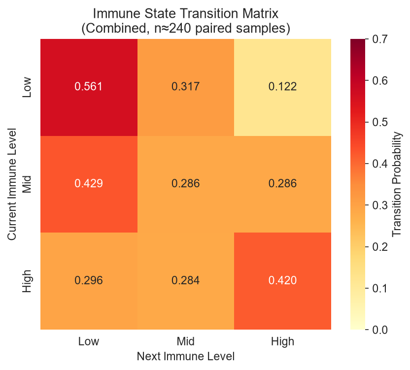
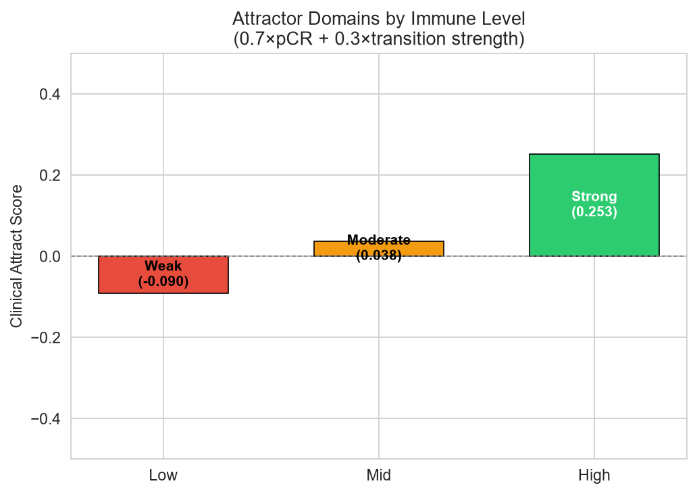
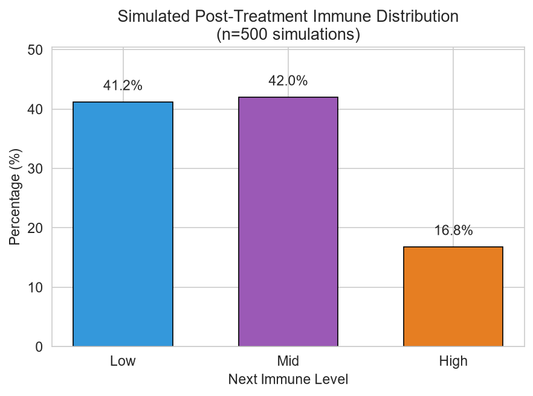

# Showcase


These figures summarize the current stage of the project.

## Immune State Transition Matrix



**What it shows**: Probability of moving from one immune level to another after treatment, estimated from ~240 paired pre/post samples across multiple GEO datasets.

**Key observation**: Low immune state tends to stay Low (0.56), while High immune state has a higher chance of remaining High (0.42).

## Attractor Domains



**What it shows**: Clinical attract score combining pCR rate (from I-SPY2) and transition tendency.

- **Strong** (High immune): higher pCR and more likely to stay high
- **Moderate** (Mid)
- **Weak** (Low): lower pCR and tends to stay low

## Simulated Post-Treatment Distribution



**What it shows**: Distribution of immune levels after one treatment step in 500 stochastic Petri net simulations.

**Note**: Current simulations are dominated by Low/Mid outcomes, reflecting the limited upward mobility observed in the transition matrix.

## Regenerating Figures

To regenerate these figures:

```bash
python scripts/generate_showcase_figures.py
```
